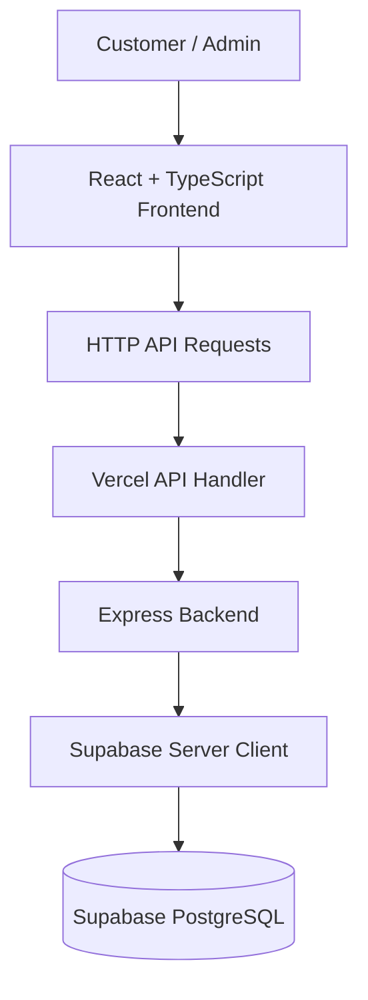

# MRDĀ — A Café Experience, Digitally Reimagined

<p align="center">
  <a href="https://atmrda.vercel.app">
    
  </a>
</p>

<p align="center">
  <strong>A quiet place for good company.</strong><br/>
  A premium digital experience crafted for MRDĀ — where thoughtful design meets the warmth of café culture.
</p>

<p align="center">
  <a href="https://atmrda.vercel.app">Live Website</a>
  ·
  <a href="https://github.com/Darpan0710/MRDA-CAFE">Source Code</a>
  ·
  <a href="https://www.instagram.com/at.mrda/">Instagram</a>
</p>

---

## The Experience

MRDĀ is a full-stack café website designed to translate the atmosphere of a modern café into a thoughtful digital experience.

Inspired by editorial design and contemporary hospitality brands, the platform brings together menu discovery, the café's story, its physical space, and table reservations in one cohesive experience.

The goal was simple: **make the website feel like an extension of the café itself.**

From the first interaction to exploring the menu, every section is designed to feel intentional, refined, and easy to navigate.

---

## Preview

<p align="center">
  <a href="https://atmrda.vercel.app">
    
  </a>
</p>

<p align="center">
  <em>Explore the live experience: <a href="https://atmrda.vercel.app">atmrda.vercel.app</a></em>
</p>

> **Preview note:** Replace this placeholder with a real screenshot of the website when adding project visuals.

---

## What Makes MRDĀ Special?

<table>
  <tr>
    <td width="50%">
      <h3>01 · Editorial Design</h3>
      A refined visual language inspired by premium hospitality and magazine layouts, with carefully considered typography, spacing, and imagery.
    </td>
    <td width="50%">
      <h3>02 · Distinct Menu Experiences</h3>
      Explore the café's food and beverage offerings through the dedicated Plated and Poured experiences.
    </td>
  </tr>
  <tr>
    <td width="50%">
      <h3>03 · The Space & Story</h3>
      Discover the café's atmosphere, interiors, and identity through dedicated storytelling sections.
    </td>
    <td width="50%">
      <h3>04 · Full-Stack Functionality</h3>
      A connected backend and database support the website's operational features, including menu and reservation management.
    </td>
  </tr>
</table>

---

## Features

### Customer Experience

- **Home** — An immersive introduction to MRDĀ and its identity.
- **Menu Overview** — A magazine-inspired gateway to the café's menu.
- **Plated** — A dedicated experience for food offerings.
- **Poured** — A dedicated experience for beverages.
- **The Space** — Explore the café's atmosphere and interiors.
- **Our Story** — Discover the identity behind MRDĀ.
- **Visit Us** — Find information for visiting the café.
- **Table Reservations** — A convenient way for customers to request a table.
- **Responsive Interface** — Designed to provide a thoughtful experience across desktop, tablet, and mobile.

### Admin & Operations

- Menu item management
- Menu availability controls
- Reservation management
- Booking-slot availability controls
- Supabase-backed data management

---

## Design Direction

MRDĀ's visual identity is built around a calm, editorial approach.

| Design Element | Direction |
|---|---|
| Visual Mood | Premium, warm, minimal, editorial |
| Primary Identity | Terracotta / deep red |
| Plated Palette | `#8B3A34` |
| Poured Palette | `#1E394C` · `#142836` |
| Layout Approach | Magazine-inspired compositions |
| Experience Goal | Elegant, intuitive, and responsive |

The design avoids unnecessary visual complexity, allowing the café's identity, imagery, and content to take center stage.

---

## Technology Stack

<p align="center">
  
  
  
  
  
  
</p>

| Layer | Technology |
|---|---|
| Frontend | React |
| Language | TypeScript |
| Build Tool | Vite |
| Backend | Node.js · Express |
| Database | Supabase PostgreSQL |
| API Deployment | Vercel Functions |
| Frontend Deployment | Vercel |
| Version Control | Git · GitHub |

---

## Architecture

MRDĀ follows a client-server architecture. The frontend communicates with the backend API, which handles server-side data operations through Supabase.



### Architecture Highlights

- React and Vite power the customer-facing interface.
- The backend handles API requests and data operations.
- Supabase PostgreSQL stores application data.
- The Supabase secret key is intended for server-side use only.
- Vercel hosts the deployed application and configured API routes.

---

## Getting Started

Want to explore the project locally? Follow the steps below.

### Prerequisites

Make sure you have:

- [Node.js](https://nodejs.org/)
- npm
- [Git](https://git-scm.com/)
- A Supabase project

### 1. Clone the Repository

```bash
git clone https://github.com/Darpan0710/MRDA-CAFE.git
cd MRDA-CAFE
```

### 2. Install Dependencies

```bash
npm install
```

### 3. Configure Environment Variables

Create a `.env.local` file in the project root.

Add the environment variables required by the application:

```env
SUPABASE_URL=your_supabase_project_url
SUPABASE_SERVICE_ROLE_KEY=your_supabase_secret_key

SESSION_SECRET=your_secure_session_secret

ADMIN_ID=your_admin_id
ADMIN_PASSWORD=your_admin_password
```

Use the exact variable names expected by the current application configuration.

> **Security:** Never commit `.env.local` or expose your Supabase secret key in frontend code. Keep all private credentials on the server.

### 4. Configure Supabase

1. Create a project in the [Supabase Dashboard](https://supabase.com/dashboard).
2. Open the SQL Editor.
3. Run the database schema SQL provided with the project.
4. Run the seed SQL if demo data is required.
5. Add the project URL and server-side secret key to `.env.local`.

### 5. Start the Development Server

```bash
npm run dev
```

Open the local URL displayed in your terminal.

---

## Build & Validation

Create a production build:

```bash
npm run build
```

Run the configured TypeScript validation:

```bash
npm run lint
```

The project has been validated with dependency installation, TypeScript checks, and a production build during deployment preparation.

---

## Deployment

MRDĀ is deployed on Vercel.

<p align="center">
  <a href="https://atmrda.vercel.app">
    
  </a>
</p>

### Deployment Overview

1. The source code is maintained in GitHub.
2. Vercel is connected to the repository.
3. The frontend is built using Vite.
4. API requests are routed through the configured Vercel API handler.
5. Supabase environment variables are configured in the Vercel project settings.

**Live URL:** [https://atmrda.vercel.app](https://atmrda.vercel.app)

---

## Project Structure

The application is organized around the frontend, backend API, and shared configuration.

```text
MRDA-CAFE/
├── api/
│   └── index.ts             # Vercel API entry point
├── src/                     # Frontend application
├── server/                  # Backend modules
├── public/                  # Static assets
├── data/                    # Local development data, if applicable
├── .env.local               # Local environment variables (not committed)
├── .gitignore
├── package.json
├── package-lock.json
├── tsconfig.json
├── vite.config.ts
├── vercel.json
└── README.md
```

*The structure above is a high-level overview. Refer to the repository for the complete implementation.*

---

## Learning & Development

This project brings together several practical full-stack development concepts:

- Building responsive interfaces with React and TypeScript
- Creating a consistent visual identity across multiple pages
- Designing and integrating backend APIs
- Working with Supabase PostgreSQL
- Managing environment variables and server-side secrets
- Configuring Vercel deployment and API routing
- Maintaining a GitHub-based development workflow

---

## Connect

<p align="center">
  <strong>MRDĀ — Plated, Poured & Everything In Between.</strong>
  <br/><br/>
  <a href="https://atmrda.vercel.app">Visit the Website</a>
  &nbsp;·&nbsp;
  <a href="https://github.com/Darpan0710/MRDA-CAFE">Explore the Code</a>
  &nbsp;·&nbsp;
  <a href="https://www.instagram.com/at.mrda/">Follow MRDĀ</a>
</p>

---

<p align="center">
  <sub>Designed and developed with care for the MRDĀ café experience.</sub>
</p>
